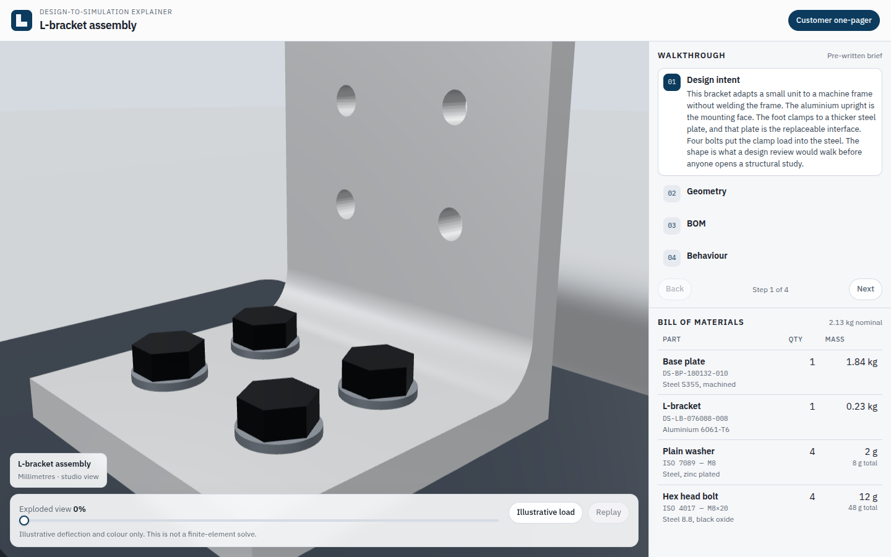

# L-bracket assembly

A static design-to-simulation explainer. It walks one bolted L-bracket from design intent, through the geometry and the bill of materials, to an exaggerated picture of how the upright leans under a lateral load.

The load picture is illustrative. It is not a finite-element solve and not a released structural result. There is no backend and no API key. A later generated narrative can be plugged in through `NarrativeSource` without changing the viewer.



## Run it

```bash
npm install
npm run dev
```

Open the URL Vite prints (usually http://127.0.0.1:5173/).

```bash
npm run build
npm run preview
```

`npm run build` typechecks and writes a static site to `dist/`.

## What the demo does

- Orbit a procedural assembly: steel base plate, aluminium L-bracket with an inside fillet and clearance holes, four hex bolts, four washers.
- Drag **Exploded view** to separate the stack along the bolt axis.
- Read the bill of materials from `src/data/bom.json`. Click a row to highlight that part, or hover a solid to highlight its row.
- Turn on **Illustrative load**. An arrow appears, the upright bends, and a blue-to-red colour runs across the bracket. The on-screen note says this is not a finite-element solve.
- Step through **Design intent**, **Geometry**, **BOM**, and **Behaviour**. Each step sets the camera, the explode amount, and whether the load plays. The copy lives in `src/data/story.ts`.
- Open **Customer one-pager** for a print layout: a snapshot of the current WebGL view (`preserveDrawingBuffer` and `canvas.toDataURL`), the four steps, and the BOM. **Print / Save as PDF** uses the browser print dialog.

If WebGL is unavailable, the 3D view is replaced with a short message. The story, the BOM, and the one-pager still open.

## Subpath hosting

Vite's `base` is read from `VITE_BASE_PATH` at dev and build time. Leave it unset for local use. For a host that serves the app under a subpath:

```bash
VITE_BASE_PATH=/bracket-explainer/ npm run build
```

See `.env.example`. This repo does not include a deployment workflow or GitHub Pages config.

## Where a generated narrative would plug in

`src/narrative/NarrativeSource.ts` is the hook. v1 uses `staticNarrative`, which returns the pre-written steps and does not call the network. A later source can implement the same interface (sync or async) and be passed to `DemoProvider`. Keep each step's camera, explode, and load cues so the view still has something to follow.
