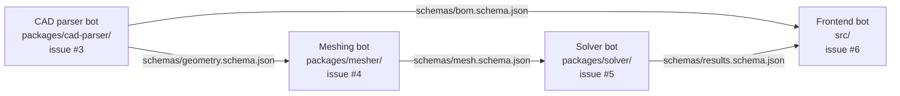

# v2 architecture plan

## Status

v1 is built and live. It is a static Vite + React + TypeScript + three.js design-to-simulation explainer, shipped with Cursor cloud agents through [PR #1](https://github.com/silverclaimer42/bracket-explainer/pull/1) (the app) and [PR #2](https://github.com/silverclaimer42/bracket-explainer/pull/2) (GitHub Pages). The live site is [https://silverclaimer42.github.io/bracket-explainer/](https://silverclaimer42.github.io/bracket-explainer/). The v1 load picture is illustrative; it is not a finite-element solve.

v2 is a plan only. It is intended to be built with four Devin sessions, coordinated through GitHub issues and pull requests. **No Devin work has been done yet.** This document and the linked issues describe the plan. They do not claim that any of the pipeline bots already exist.

## Pipeline

Each arrow is a JSON-schema contract. A later stage must not start work against an ad-hoc payload; it consumes documents that validate against the named schema.

## Bots

### 1. CAD parser bot

- **Issue:** [#3](https://github.com/silverclaimer42/bracket-explainer/issues/3)
- **Owned folder:** `packages/cad-parser/`
- **Role:** STEP/STL in, normalised geometry and BOM JSON out, using OpenCascade.js.
- **Contracts:** writes `schemas/geometry.schema.json` and `schemas/bom.schema.json`.
- **Upstream:** none (first stage).
- **Downstream:** meshing bot ([#4](https://github.com/silverclaimer42/bracket-explainer/issues/4)) consumes geometry; frontend bot ([#6](https://github.com/silverclaimer42/bracket-explainer/issues/6)) consumes the BOM.

### 2. Meshing bot

- **Issue:** [#4](https://github.com/silverclaimer42/bracket-explainer/issues/4)
- **Owned folder:** `packages/mesher/`
- **Role:** tetrahedral mesh with refinement at bolt holes and fillets, using gmsh compiled to WebAssembly.
- **Contracts:** reads `schemas/geometry.schema.json`; writes `schemas/mesh.schema.json`.
- **Upstream:** CAD parser bot ([#3](https://github.com/silverclaimer42/bracket-explainer/issues/3)).
- **Downstream:** solver bot ([#5](https://github.com/silverclaimer42/bracket-explainer/issues/5)).

### 3. Solver bot

- **Issue:** [#5](https://github.com/silverclaimer42/bracket-explainer/issues/5)
- **Owned folder:** `packages/solver/`
- **Role:** linear static FEA in a web worker. Reports von Mises stress, deflection, and safety factor. Validated against a hand calculation for the L-bracket.
- **Contracts:** reads `schemas/mesh.schema.json`; writes `schemas/results.schema.json`.
- **Upstream:** meshing bot ([#4](https://github.com/silverclaimer42/bracket-explainer/issues/4)).
- **Downstream:** frontend bot ([#6](https://github.com/silverclaimer42/bracket-explainer/issues/6)).

### 4. Frontend bot

- **Issue:** [#6](https://github.com/silverclaimer42/bracket-explainer/issues/6)
- **Owned folder:** `src/` (the existing app)
- **Role:** wire solver results into the existing three.js viewer and the customer one-pager. The app stays a static site with no backend and no API keys.
- **Contracts:** reads `schemas/bom.schema.json` and `schemas/results.schema.json` (and geometry/mesh as needed to render). This stage does not introduce a new schema.
- **Upstream:** CAD parser bot ([#3](https://github.com/silverclaimer42/bracket-explainer/issues/3)) and solver bot ([#5](https://github.com/silverclaimer42/bracket-explainer/issues/5)); meshing bot ([#4](https://github.com/silverclaimer42/bracket-explainer/issues/4)) is an indirect dependency.
- **Downstream:** none (last stage).

## Coordination model

- **One folder per bot.** Devin sessions should not take ownership of another bot's folder.
- **Contracts first.** Shared JSON schemas live under `schemas/`. Agree the schema in a reviewable PR before depending on an instance document.
- **Four Devin sessions**, one per issue, coordinated through those issues and their pull requests.
- **Isamuddin reviews every PR.** Do not merge to `main` without his explicit OK.

## Validation plan

- Documents at each stage boundary validate against the named JSON schema.
- The L-bracket used in v1 (or a documented equivalent STEP/STL fixture) can be run through the CAD → mesh → solve path.
- Solver results for that bracket are compared to a documented hand calculation; agreement and the limits of the comparison are recorded.
- The frontend renders those results in the three.js viewer and includes them on the customer one-pager, rather than only the v1 illustrative load picture.

## Issues

| Stage | Issue | Folder | Contracts |
| --- | --- | --- | --- |
| CAD parser | [#3](https://github.com/silverclaimer42/bracket-explainer/issues/3) | `packages/cad-parser/` | `schemas/geometry.schema.json`, `schemas/bom.schema.json` |
| Meshing | [#4](https://github.com/silverclaimer42/bracket-explainer/issues/4) | `packages/mesher/` | `schemas/mesh.schema.json` |
| Solver | [#5](https://github.com/silverclaimer42/bracket-explainer/issues/5) | `packages/solver/` | `schemas/results.schema.json` |
| Frontend | [#6](https://github.com/silverclaimer42/bracket-explainer/issues/6) | `src/` | consumes BOM + results |

All four issues are labelled `v2` and `devin`, and are titled as work to be built with Devin.
